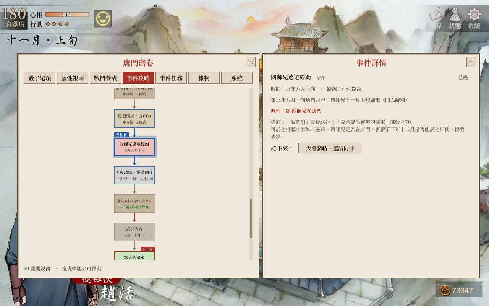
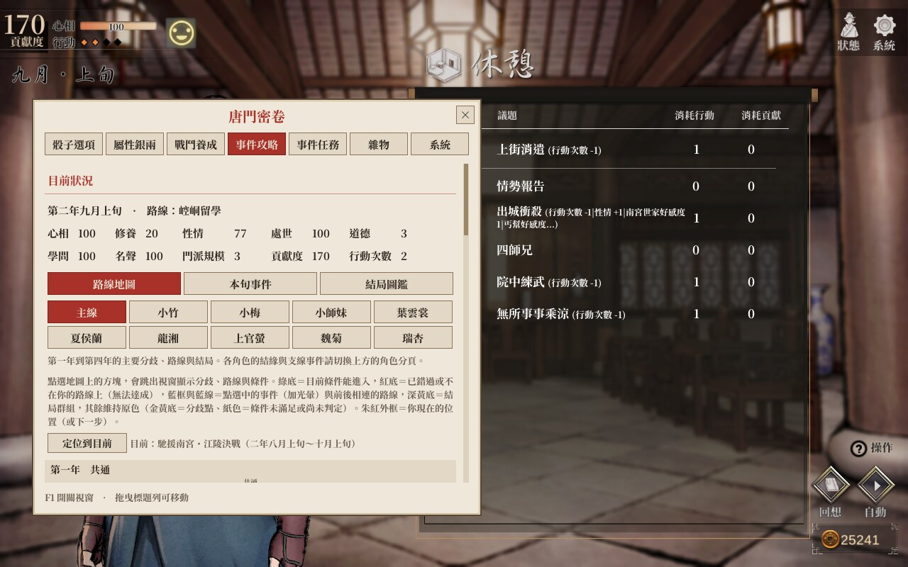
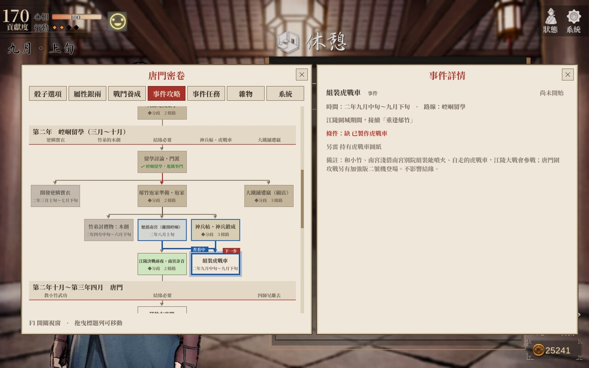
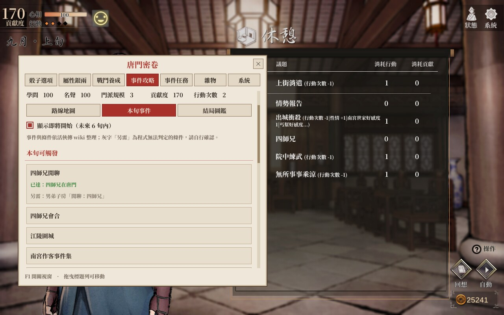
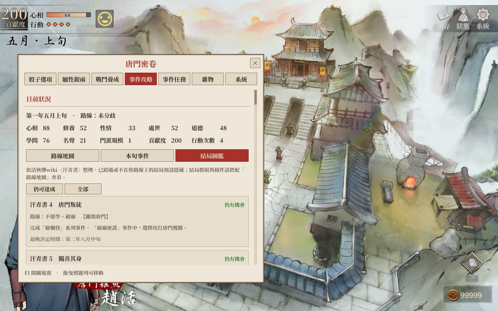
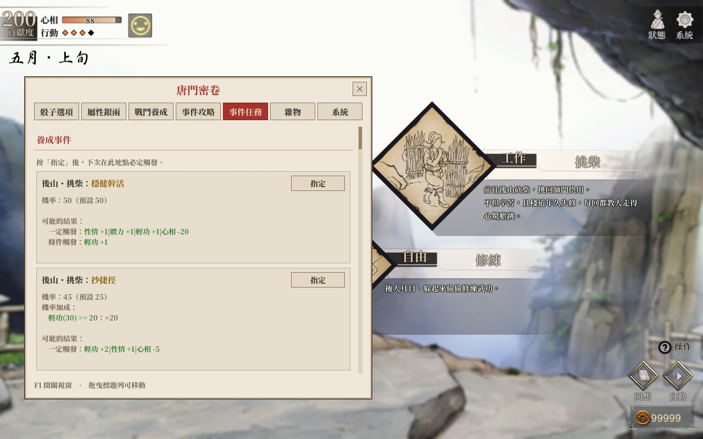
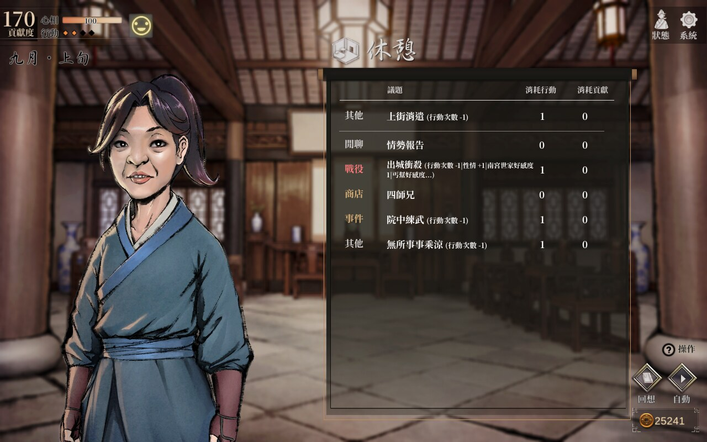
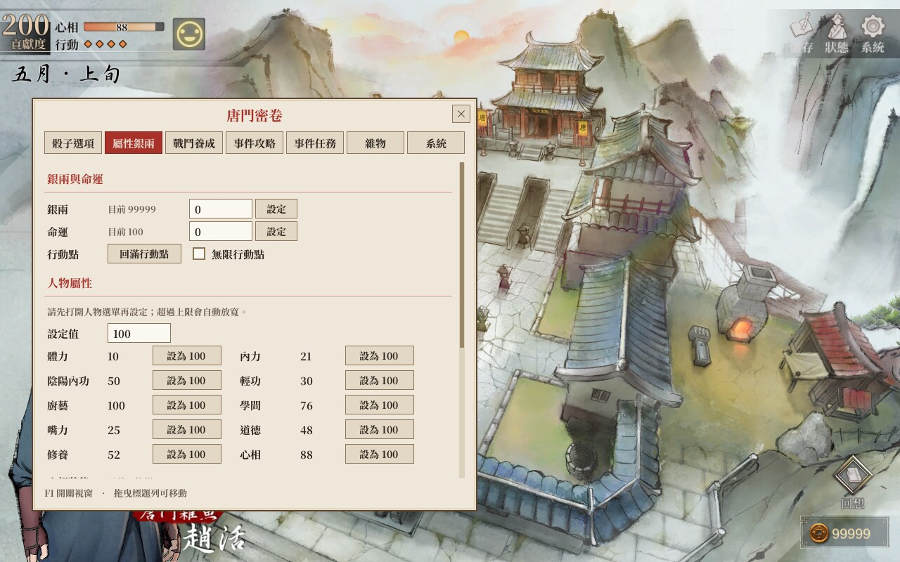

# LegendOfMortal-CheatMod

《活俠傳》（Legend of Mortal）內置 MOD，目前版本 **v1.3 Beta**。適用 Steam 版 **1.0.6001.0（崆峒神威）** 以上（1.0.6000.x 請使用 MOD v1.0），支援 Windows 與 Linux / Steam Deck。

> [!WARNING]
> **第一次玩《活俠傳》請先不要安裝這個 MOD。**
>
> 這個 MOD 會直接攤開所有路線、分歧條件、結局與結緣條件，還能指定骰子點數、修改數值，等於把整本攻略和修改器塞進遊戲裡。
> 《活俠傳》的樂趣有很大一部分來自未知：不知道選項會通往哪裡、在有限的行動次數裡取捨、錯過之後才發現的遺憾。
> 第一輪就裝上它，會大幅降低遊戲的樂趣，而且劇情和結局都會被暴雷。
>
> 建議至少自己完整玩過一輪，想補完結局、結緣或收集時再安裝。



## 安裝

1. 到 [Releases](../../releases/latest) 下載 `LegendOfMortal_InternalMod_v1.3beta_full.zip`。
   （已安裝 BepInEx 5 的玩家可改下載 `plugin_only` 版。）
2. Steam 收藏庫對《活俠傳》按右鍵 → 管理 → 瀏覽本機檔案。
3. 把壓縮檔內容全部解壓到該資料夾（`winhttp.dll` 要和 `Mortal.exe` 在同一層）。
4. **Linux / Steam Deck** 另需在 Steam → 內容 → 一般 → 啟動選項填入：
   ```
   WINEDLLOVERRIDES="winhttp=n,b" %command%
   ```
5. 從 Steam 啟動遊戲，畫面上方出現「內置MOD已載入」即安裝成功。

若遊戲資料夾已有 BepInEx 6，請先刪除 `BepInEx` 資料夾、`winhttp.dll`、`doorstop_config.ini`、`.doorstop_version`、`changelog.txt` 再安裝。

**解除安裝**：刪除 `winhttp.dll` 即停用；完全移除再刪除上述 BepInEx 相關檔案。

## 使用

- 遊戲中按 **F1** 開關「唐門密卷」視窗，拖曳標題列可移動。
- 數值類功能請先打開對應的遊戲介面（人物選單、門派介面）再設定。
- 快捷鍵與各功能預設值可在 `BepInEx/config/LegendOfMortal_InternalMod.cfg` 修改。
- 修改的數值會寫入存檔，使用前建議先備份存檔。

## 功能

| 分頁 | 功能 |
|---|---|
| 骰子選項 | 指定天命骰子點數；在劇情選項後顯示結果（如 +銀兩） |
| 屬性銀兩 | 設定銀兩、命運；回滿／無限行動點；人物屬性（含陰陽內功、心相狀態切換）；門派數值 |
| 戰鬥養成 | 單挑／群戰我方無敵、群戰一擊必殺、技能無冷卻、戰鬥不限時；武學／煉丹／鍛造三組各自可設「不消耗」「快速升級」、好感只升不降 |
| 事件攻略 | 路線地圖（主線與九位心上人的結緣線）、本旬事件、結局圖鑑，內容依 [活俠傳 wiki](https://smilin.net/LoM-wiki/) 整理 |
| 事件任務 | 列出目前地點可觸發的養成事件、機率與可能結果，並可指定必出；列出支線任務與條件並可設為必定通過 |
| 雜物 | 修改背包「雜物」數量（藥品、食物等可使用道具），可搜尋、直接設為指定數量或累加；書籍與寶物不受影響 |
| 系統 | 遊戲速度 0.5～5 倍 |

### 事件攻略：路線地圖

由上而下的指南地圖，標出第一年到第四年的分歧點、各條路線與結局群組，並依存檔旗標標示你目前的位置與已選的路。



- 分頁：主線，以及小竹、小梅、小師妹、葉雲裳、夏侯蘭、龍湘、上官螢、魏菊、瑞杏的結緣線。
- 底色依目前存檔即時判定（每秒更新）：
  - **綠底**：目前條件能進入
  - **紅底**：已錯過或不在你的路線上，無法達成
  - **深黃底**：結局群組
  - 原色：條件未滿足或尚未判定（金黃底為分歧點）
  - 朱紅外框加「目前／下一步」標籤：你現在的位置
- 點地圖上的方塊，右側會跳出「事件詳情」視窗，列出時間、路線、條件（缺少的紅字、已達成的綠字、程式無法判定的灰字）、每個選項的結果與去向。
- 點選中的事件加上藍框、光暈與「查看中」標籤，前後相連的事件與連線改用藍色，底色維持狀態色。
- 詳情視窗裡的「去向／接下來／相關」按鈕也依同樣規則上色。點下去會換成該事件的詳情，左側地圖自動切頁並捲到該事件。按 × 或 Esc 關閉詳情。

### 事件攻略：結緣線

每位心上人的結緣必要條件，以及容易錯過的分支，例如小竹的老虎戰衣、虎戰車。分頁上方會顯示目前是否已結緣、心上人是誰。



### 事件攻略：本旬事件與結局圖鑑

- **本旬事件**：依目前日期、路線與參數，列出本旬可觸發、條件不足（缺哪些參數）、即將開始的主支線事件。
- **結局圖鑑**：汗青書 66 個結局的條件，依你目前的路線標示仍可達成／已錯過。

| 本旬事件 | 結局圖鑑 |
|---|---|
|  |  |

### 事件任務

列出目前地點可觸發的養成事件（以 wiki 事件名稱顯示，如「後山・挑柴：抄捷徑」）、機率、機率加成與可能結果，按「指定」後下次在此地點必定觸發。



### 選項提示

在劇情與議題選項後面直接顯示結果，例如行動次數、屬性、好感度的變化。



### 屬性銀兩

設定銀兩、命運與行動點，人物屬性可一鍵設為指定值；心相、陰陽內功可直接切換狀態。



## v1.3 Beta 更新內容

- 路線地圖新增九位心上人的結緣線分頁。
- 事件詳情改為地圖右側的獨立視窗，不再遮住地圖。
- 節點依目前存檔的條件上色（綠＝能進入、紅＝無法達成、深黃＝結局群組），點選的路線以藍色標示。
- 從詳情跳到其他事件時，地圖會自動切頁並捲到該事件。
- 修正分頁過多時文字超出視窗、狀態文字被截斷等排版問題。

## 特別感謝

- [活俠傳 wiki](https://smilin.net/LoM-wiki/)（[GitHub：Mr-Smilin/LoM-wiki](https://github.com/Mr-Smilin/LoM-wiki)）：「事件攻略」的路線、分歧條件、結局圖鑑，以及「事件任務」的養成事件名稱，都依 wiki 整理。感謝所有編輯與貢獻者。
